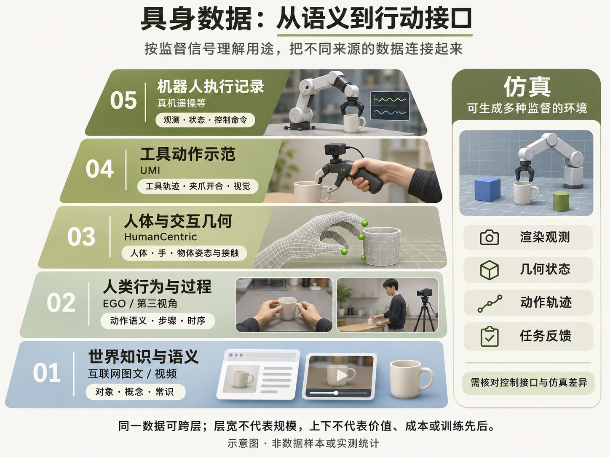
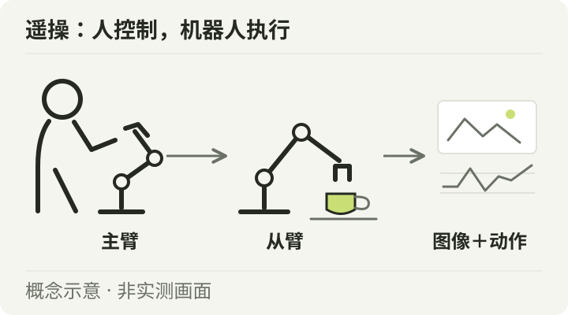
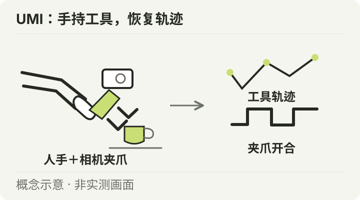
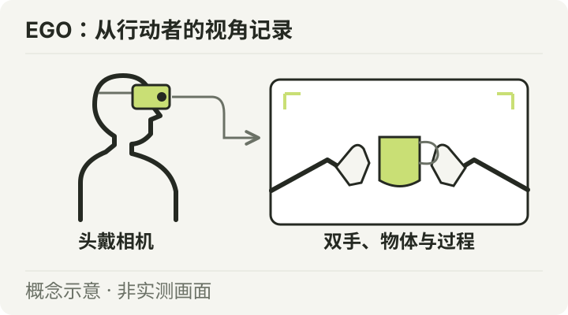
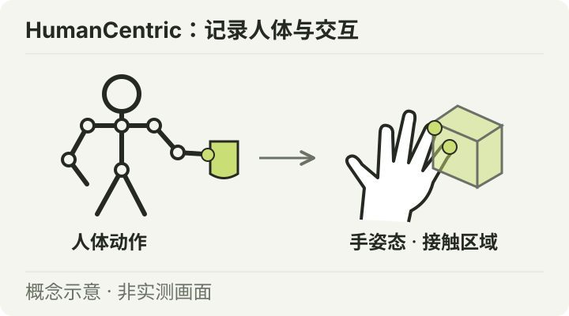
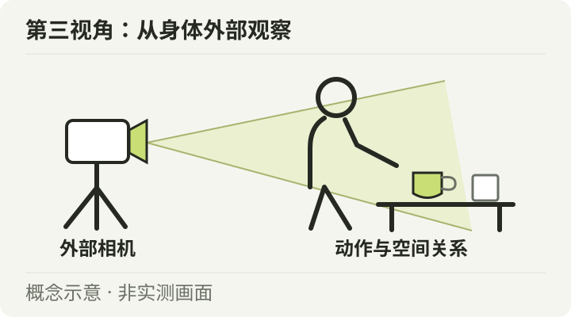
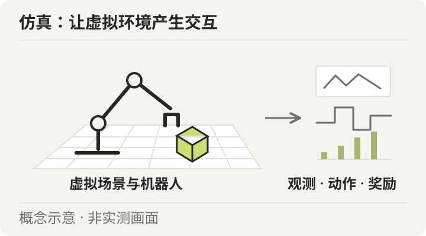

DATA ATLAS / FROM COLLECTION TO CAPABILITY

# 具身数据：从采集到能力。

机器人怎样获得经验？不同数据记录了不同层面的世界：有的告诉模型“发生了什么”，有的描述“人怎样运动”，有的进一步给出“机器人应该执行什么动作”。

本专题按 **遥操、UMI、EGO、HumanCentric、第三视角、仿真** 六个入口整理。每一类都回答三个问题：怎样采集、实际提供什么、在具身学习中负责哪一部分。先用关系图建立全貌，再看采集示意与各类官方演示。

资料核验：2026-11-15 · 以论文、官方项目页与数据文档为依据 · 代表性项目整理，非全量清单

## 从语义到行动接口：先看数据之间的关系 {#data-pyramid}

同样是“拿起杯子”，互联网图文描述杯子的概念，人类视频记录操作过程，几何数据描述手与物体的运动，工具示范和机器人日志进一步提供动作接口所需的信息。下图用这个视角连接现有的六类数据。

<figure class="data-pyramid" markdown>

<figcaption>点击图片查看大图。图内设备与场景为生成示意，并非具体项目的硬件照片或实际数据样本。</figcaption>

</figure>

01 / UNDERSTAND

**语义与行为**

互联网图文提供对象与常识；[EGO](egocentric.md) 和[第三视角](third-person.md)帮助理解人怎样完成任务。观察视角本身不决定有没有动作标签。

02 / STRUCTURE

**几何与工具动作**

[HumanCentric](human-centric.md) 关注人体、手与物体几何；[UMI](umi.md) 恢复工具轨迹与开合，可为策略学习提供动作监督，仍需核对目标机器人接口。

03 / EXECUTE

**执行与可控生成**

[遥操](teleoperation.md)记录机器人执行时的观测、状态与命令；[仿真](simulation.md)能生成多种监督信号，因此单列在侧栏。

读图口径：分层表示描述对象和接口差异，同一数据可以跨层或联合使用。层宽不代表数量，上下不代表价值、采集成本、训练先后或策略能力高低；奖励与任务结果仍以实际发布字段为准。

这一组织方式依据各项目提供的信号与接口，是本站的阅读视角：[UMI 的工具动作与策略学习](https://umi-gripper.github.io/)、[Open X-Embodiment 的动作语义说明](https://github.com/google-deepmind/open_x_embodiment)、[ManiSkill 的轨迹与观测格式](https://maniskill.readthedocs.io/en/latest/user_guide/datasets/demos.html)。

## 六种入口，不是六个互斥的桶

这套分类同时包含**采集方式**（遥操、UMI）、**相机视角**（EGO、第三视角）、**内容与标注重点**（HumanCentric）和**环境来源**（仿真）。同一份数据可以同时属于多个入口：遥操数据可包含第三视角相机，人体交互数据可同时有第一和第三视角，仿真也可以由人遥操采集。

这里将 **EGO** 用作 egocentric，即第一人称视角；将 **HumanCentric** 用作以人体、手及人与物体交互为核心的动作或几何数据。这是本专题的组织口径，阅读具体数据集时仍以其官方定义与字段为准。

01

真实机器人 · 人在控制回路中

### [遥操 Teleoperation →](teleoperation.md)

{ .data-route-visual loading=lazy width=720 height=400 }

[观看官方演示 →](teleoperation.md#visual-guide){ .data-watch-link }

人通过主从机械臂、手柄或其他接口控制机器人，记录执行中的观测、状态与动作。最直接服务于机器人策略模仿。

代表项目：ALOHA · DROID · BridgeData V2

02

手持工具 · 采集时不必带机器人

### [UMI 手持交互数据 →](umi.md)

{ .data-route-visual loading=lazy width=720 height=400 }

[观看官方演示 →](umi.md#visual-guide){ .data-watch-link }

人手持带相机的夹具完成任务，通过轨迹恢复与接口设计，把人的示范连接到机器人的操作策略。

代表项目：UMI · FastUMI · DexUMI

03

第一人称 · 任务与交互上下文

### [EGO 第一视角 →](egocentric.md)

{ .data-route-visual loading=lazy width=720 height=400 }

[观看官方演示 →](egocentric.md#visual-guide){ .data-watch-link }

用头戴等可穿戴相机记录人的活动，提供动作语义、时序过程及手物交互经验，通常需要额外步骤才能用于机器人控制。

代表项目：Ego4D · EPIC-KITCHENS · Ego-Exo4D

04

人体与手 · 动作、几何与接触

### [HumanCentric 人体交互 →](human-centric.md)

{ .data-route-visual loading=lazy width=720 height=400 }

[观看官方演示 →](human-centric.md#visual-guide){ .data-watch-link }

通过动作捕捉、多视角重建或模型拟合获得人体、手和物体的结构化运动，用于动作先验、交互理解及重定向研究。

代表项目：AMASS · GRAB · ARCTIC · DexYCB

05

外部观察 · 完整动作与空间关系

### [第三视角 Exocentric →](third-person.md)

{ .data-route-visual loading=lazy width=720 height=400 }

[观看官方演示 →](third-person.md#visual-guide){ .data-watch-link }

从外部相机观察人或机器人，研究动作识别、技能过程和多视角关联。外部视频本身不提供统一的机器人动作接口。

代表项目：Assembly101 · Ego-Exo4D · NTU RGB+D

06

虚拟环境 · 可重复交互与验证

### [仿真 Simulation →](simulation.md)

{ .data-route-visual loading=lazy width=720 height=400 }

[观看官方演示 →](simulation.md#visual-guide){ .data-watch-link }

用规划器、专家策略、遥操或在线交互生成轨迹，可用于模仿学习、强化学习和评测；记录内容由具体环境与导出配置决定。

代表项目：RLBench · ManiSkill · LIBERO · Habitat

## 一眼比较：数据距离机器人动作还有多远

下表是对各类数据的**使用判断**，不是每个项目都提供全部所列字段。是否能够监督策略，需要检查具体发布版本和目标机器人的接口。

左右滑动查看完整对照 →

| 数据入口 | 典型采集方式 | 可能提供的监督 | 在具身中的主要定位 | 接到机器人还需处理什么 |
| --- | --- | --- | --- | --- |
| 遥操 | 人操纵主设备、手柄等，机器人执行 | 同步图像、本体状态、控制指令；任务信息视项目而定 | 行为克隆、视觉动作策略、VLA 的机器人训练部分 | 本体差异、动作语义、频率、延迟与失败覆盖 |
| UMI | 人手持夹具操作，恢复工具轨迹 | 视觉、夹具位姿与开合等；依具体硬件与处理流程 | 便携地采集操作示范，学习可部署的工具动作策略 | 轨迹质量、可达性、夹具适配、控制与延迟匹配 |
| EGO | 头戴或其他第一人称相机记录活动 | 视频、叙述、动作片段；部分项目有额外传感或几何标注 | 场景与任务理解、时序表征、动作预判、手物交互学习 | 补充或推断动作与几何，并处理人机视角及本体差异 |
| HumanCentric | 动捕、多视角、RGB-D、人体或手模型拟合 | 身体或手姿态、形状、物体位姿；接触标注依项目而定 | 人类动作先验、运动生成、人机动作重定向与交互建模 | 骨架映射、运动学与动力学约束、接触与可执行性 |
| 第三视角 | 外部固定、移动或多相机观察 | 动作类别、步骤、时序、姿态或多视角对应 | 动作理解、技能过程、跨视角表示与几何监督 | 相机标定、空间恢复、动作推断及机器人接口转换 |
| 仿真 | 脚本、规划器、专家策略、遥操或在线采样 | 观测、动作、仿真状态、任务结果；奖励与标注按配置 | RL 交互、IL 示范、受控对照与泛化评测 | 训练和部署可见信息一致、仿真差异、真机闭环验证 |

读完总览后，可到六篇分类笔记查看代表项目的实际采集流程与字段。比如，[UMI 官方项目](https://umi-gripper.github.io/)明确将手持夹具、相对轨迹动作表示和延迟匹配组合起来；这种工具示范与普通人的第一视角录像，提供的控制监督不同。

## 数据在训练链条中的位置

**理解层**关注看见了什么、正在做什么、下一步可能发生什么。EGO、第三视角和部分 HumanCentric 数据常为视觉语言与时序表示提供素材。视频里的动作类别是语义标签，不能直接替代电机或末端控制指令。

**动作与交互先验**关注身体怎样移动、手怎样接近物体、人与环境怎样接触。结构化人体数据能提供这类规律，但将人的骨架动作转给机器人仍需要重定向和物理约束。[人体交互笔记](human-centric.md)会区分原始观测、重建结果与可执行动作。

**策略学习层**需要把观测与动作在时间上对齐。真实机器人遥操、经过处理的 UMI 示范和部分仿真示范可以提供这样的对应关系；数据是否适合某台机器人，仍由控制接口决定。离线 RL 还需要与算法目标相容的任务反馈或奖励构造，不能把所有示范集都直接称为离线 RL 数据。

**交互与验证层**需要任务定义、初始分布、成功判定与独立测试。仿真器可以持续产生新的交互数据，也可以生成固定示范集；一个环境、一个数据集和一个评测基准是不同对象。真机评测必须另有实物试验依据。

## 数据集、汇合集与格式，要分开理解

[Open X-Embodiment](https://github.com/google-deepmind/open_x_embodiment)把多个机器人数据集组织成统一的 RLDS episode 格式，便于读取和研究跨机器人学习。它是跨来源的汇集，不是一种新的采集方式。官方文档也明确提醒：动作维度可能表示绝对值、增量或速度，不能只看数组长度。

[LeRobotDataset v3](https://huggingface.co/docs/lerobot/lerobot-dataset-v3)是一种数据组织格式与访问接口，用表格、视频和元数据组织时序信号。数据“已经转成 LeRobot 格式”，并不意味着已经解决动作坐标、单位、控制器或训练分布的差异。

READ A DATASET BEFORE TRAINING

## 使用前，先读清这六项

1. **采集对象与本体**：人、手持工具还是真实机器人？哪个机器人、执行器与相机配置？
2. **原始数据与派生标签**：哪些是传感器实测，哪些由人工标注、模型估计或仿真生成？
3. **动作与时间**：控制量的含义、单位、坐标系、采样频率和对齐方式是否明确？
4. **任务与覆盖范围**：只包含成功示范，还是也有失败、纠正和恢复？训练集覆盖哪些场景？
5. **评测划分**：是否按人物、物体、场景或任务区分测试集，避免同一轨迹近邻帧造成泄漏？
6. **发布版本与访问条件**：记录版本、下载说明和数据本身的许可；代码开源不等于所有原始数据可直接使用。

[从遥操数据开始 →](teleoperation.md){ .md-button .md-button--primary }
[回到具身知识全貌](../embodied-ai-overview.md){ .md-button }

