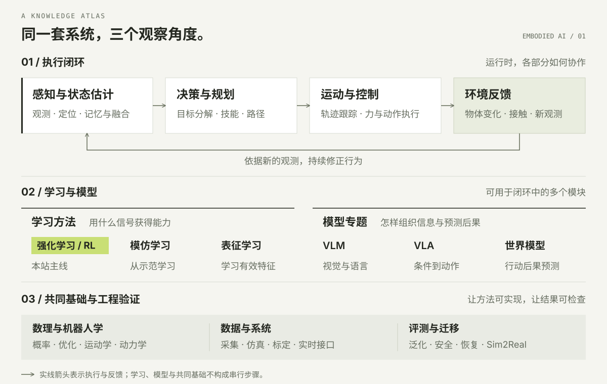

01 / THE BIG PICTURE

# 具身智能，先看清系统。

一个机器人怎样看见世界、决定行动，并从结果中修正自己？从这个问题出发，把系统的职责、能力的来源和实现的条件连接起来。

**先理解运行闭环，再学习方法，最后用实验检验。** 这三种视角，构成本站的知识地图。

想从实例入门，可以从[四篇快速概览](quick-overview/concept.md)开始，在[四类任务的交互动画](quick-overview/tasks.md)里试试看机器人怎样拿稳、推准、站稳和绕路。

小屏幕可横向滑动查看；[打开完整知识地图 ↗](assets/diagrams/embodied-ai-map.svg)

[01 · 系统怎样运行](#system-loop) [02 · 能力怎样获得](#learning-models) [03 · 怎样实现与验证](#foundations-engineering)

01 / SYSTEM

## 系统怎样运行 {#system-loop}

具身智能以身体为行动的载体，通过与环境持续交互完成任务。以“机械臂把杯子放进托盘”为例，先明确可用传感器、动作接口与成功条件，再观察下面三个环节怎样配合。杯子进入托盘后是否稳定、有无碰撞、是否需要人工干预，都应在任务开始前写清。导航、行走和人机协作也需要各自明确的任务边界。

<article class="atlas-topic" markdown>

### 感知与状态估计 {#perception}

**现在发生了什么？**

相机提供图像，编码器提供关节读数，触觉与力觉补充接触信息。系统需要据此估计杯子位姿、机械臂状态，以及是否已经抓稳。

观测不等于完整状态：单帧图像可能无法确定速度，遮挡也可能隐藏关键物体。因此需要多传感器融合、历史或记忆。导航侧重定位与建图，操作侧重物体位姿与接触状态。

**主要知识**：视觉与多模态感知、定位、SLAM、状态估计、部分可观测性。

</article>

<article class="atlas-topic" markdown>

### 决策与规划 {#planning}

**下一步做什么，怎样到达？**

任务规划决定抓取、移动、放置的先后关系；运动规划寻找避开障碍的路径；轨迹生成进一步考虑时间、速度和动力学约束。

几何上可行的路径，还需要转化为身体能够执行的运动。规划器可以调用学习到的技能，也可以根据新观测重新规划。各环节怎样分工，取决于任务和执行条件。

**主要知识**：任务分解、技能选择、运动规划、轨迹优化、模型预测控制。

</article>

<article class="atlas-topic" markdown>

### 运动与控制 {#body-control}

**怎样让身体完成这个动作？**

策略输出可能是关节力矩、目标关节角或末端位姿增量。若输出目标位置，底层控制器还要根据实际反馈持续修正，完成跟踪。

机构、执行器、负载和接触决定身体的能力边界。控制频率、动作单位、坐标系与延迟必须明确；同一个算法换了这些条件，可能面对完全不同的控制问题。

**主要知识**：反馈控制、PD/PID、阻抗控制、最优控制、轨迹跟踪。

</article>

**动作改变环境，新的观测再进入系统，闭环由此形成。** 杯子滑动或抓取失败后，机器人需要修正后续行为。任务规划、策略推理和底层控制也可能运行在不同频率上。

这是功能分解，不要求每一项都对应独立软件模块。端到端策略可以合并其中一些步骤，但仍需处理观测噪声、物理约束与反馈。机器人学的系统联系可参考 [Modern Robotics](https://hades.mech.northwestern.edu/index.php/Modern_Robotics) 与 [Underactuated Robotics](https://underactuated.mit.edu/)。

02 / LEARNING

## 能力怎样获得 {#learning-models}

感知、规划和控制描述系统承担的职责；学习方法描述能力怎样从数据和经验中获得；模型则规定信息如何表示、预测或转化为动作。这几个维度可以组合。

<article class="atlas-topic" markdown>

### 学习方法 {#policy-learning}

**学习信号从哪里来？**

- **模仿学习**：利用示范学习行为，例如用行为克隆拟合观测与动作的对应关系。
- **强化学习**：通过奖励与长期回报评价行为，利用价值估计和策略优化改进行动。
- **表征学习**：从数据中获得适合感知、预测或决策的特征。

离线与在线描述学习期间能否继续获取交互数据。RL 可以使用固定数据，模仿学习也可以通过采集新的示范或纠正来迭代。机器人示范学习的实例见 [robomimic](https://robomimic.github.io/)。

本站以 **RL 作为当前深入学习的主线**。高层技能选择和低层运动控制可以共享这套理论，但必须分别定义观测、动作、奖励和执行周期。

[进入强化学习十章 →](rl/index.md)

</article>

<article class="atlas-topic" markdown>

### 策略模型、基础模型与世界模型 {#foundation-world-models}

**模型接收什么，输出什么？**

- **视觉动作策略**：从图像、本体状态等条件产生动作，例如 [ACT](policies/act.md) 使用示范学习动作块。
- **VLM**：连接视觉与语言，可提供语义理解。
- **VLA**：将视觉和语言条件接到动作输出；它可以由示范训练，也可以结合其他学习方法。
- **世界模型**：预测环境演化，尤其关注行动的后果，可用于规划或策略改进。

[RT-2](https://robotics-transformer2.github.io/)将机器人轨迹与视觉语言任务结合训练；[DreamerV3](https://arxiv.org/abs/2301.04104)在学习到的世界模型中改进行为。它们展示了模型与学习方式如何配合。

VLA 并不等于某一种训练算法，世界模型也不固定属于高层决策。预测是否逼真与能否支持控制，需要分别通过预测质量和闭环任务效果检验。

[进入策略模型地图 →](policies/index.md) · 从 [ACT](policies/act.md) 读到 [SmolVLA](policies/smolvla.md) 与 [π₀](policies/pi0.md)，比较输入条件、动作生成和训练方式。

</article>

例如，一个抓取系统可以用视觉模型处理图像，用模仿学习训练动作策略，再由反馈控制器执行。也可以引入交互学习或世界模型。组合是否有价值，要与任务基线比较，不能仅凭模型名称判断。

03 / FOUNDATIONS & EVIDENCE

## 怎样实现与验证 {#foundations-engineering}

一个可工作的系统，需要数学和机器人学描述问题，需要数据与仿真开展实验，也需要可靠的工程接口和独立评测。下面三部分贯穿整个闭环。

<article class="atlas-topic" markdown>

### 数学与机器人学基础 {#foundations}

**能否准确描述这个问题？**

线性代数与几何描述坐标和位姿；概率统计处理不确定性；微积分、力学与优化连接运动、目标和约束。

机器人学中，运动学研究关节与末端运动的关系，动力学研究力、力矩与运动的关系。它们帮助判断一个动作是否可达、可执行，以及为什么会失败。

基础知识可以围绕任务补齐：学习位姿时补坐标变换，学习价值估计时补条件期望。Python、数值计算与实验设计帮助把理解变成可复查的结果。

</article>

<article class="atlas-topic" markdown>

### 数据、仿真与迁移 {#data-simulation}

**训练覆盖了哪些情况？**

图像是数据模态，遥操作是采集方式，模仿学习是训练用途。动作数据还需要单位、坐标系、时间戳与控制接口；格式相同并不保证物理含义相同。

仿真提供可重复的环境。系统辨识、域随机化和适应方法用于处理模型与部署环境的差异，迁移效果仍需目标环境的测试证据。

[仿真专题](simulation/index.md)从刚体、接触与物理求解器出发，解释时间推进与控制频率，再用振子和 MuJoCo 接触实验检查数值结果。

沿[具身数据地图](data/index.md)，可以继续比较遥操、UMI、EGO、HumanCentric、第三视角和仿真数据的采集与训练用途。

数据划分应区分新物体、新场景与新任务。[Open X-Embodiment](https://robotics-transformer-x.github.io/)提供跨机器人数据与策略研究的入口。

</article>

<article class="atlas-topic" markdown>

### 系统、评测与安全 {#systems-evaluation}

**能否稳定完成，而且解释失败？**

通信、标定、时间同步、推理延迟和控制频率影响实际行为。日志应串起输入、动作、反馈与版本，支持区分感知、决策和执行问题。

训练奖励服务优化，任务指标评价完成情况，安全约束规定不可接受的行为。固定测试条件后，报告成功次数与总次数、耗时、人工干预和失败类型。

新场景、扰动与失败恢复需要单独验证。仿真成绩和一次成功视频，都不足以说明真机反复执行的可靠性。

</article>

YOUR NEXT STEP

## 学习路径

先用这张地图确定位置，再沿一条主线深入，最后用具体任务连接相邻知识。

1. **理解决策的数学基础。** [RL 十章](rl/index.md)按赵世钰《Mathematical Foundations of Reinforcement Learning》2024 年 9 月版编排，已有伴读、统一符号与机制实验。
2. **把变量落实到物理接口。** 阅读[从 RL 到具身任务](rl/to-embodied.md)，明确观测、动作语义、控制周期与成功条件，再选择一个小型任务。
3. **逐项增加难度与证据。** 机器人控制、模仿学习、VLA 和迁移实验按[路线与进度](roadmap.md)继续建设；总览中的知识方向不代表这些实验已经完成。

研究一个新方法时，记录它解决什么任务、改变系统哪部分、依赖什么数据与接口，以及哪些测试支持结论。让知识随可检查的证据逐步增长。

[开始阅读 RL 主线](rl/index.md){ .md-button .md-button--primary }
[查看学习路线](roadmap.md){ .md-button }

