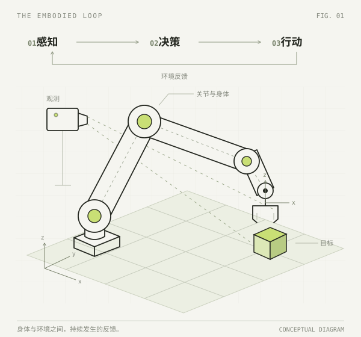

EMBODIED INTELLIGENCE / FIELD NOTES

# 具身智能， 从全貌到行动。

理解机器人如何感知世界、作出决策与完成行动。 从一张知识地图开始，沿一条主线深入，再用实验核对理解。

[探索知识全貌 ↗](embodied-ai-overview.md){ .action-primary }
[开始学习 RL →](rl/index.md){ .action-text }

 中文伴读 · 数值实验 · 持续修订

FIG. 01 &nbsp; 身体与环境之间，智能形成闭环。

01 / START HERE

## 一条清楚的阅读路径

先知道知识在系统中的位置，再进入公式与实现。

01

### 建立全貌

分清执行闭环、学习方法与共同基础。把 RL、VLA 和世界模型放回各自的位置。

[阅读知识地图 →](embodied-ai-overview.md)

02

### 深入一条主线

按教材十章理解状态、价值与策略，从 Bellman 方程走到 Actor-Critic。

[进入强化学习 →](rl/index.md)

03

### 用实验核对

观察真实数值更新，暂停、单步与调整参数，再对照本地 Python 实现。

[打开实验室 →](labs/textbook.md)

THE CORE TRACK

## 强化学习。 从目标，到策略。

以赵世钰《Mathematical Foundations of Reinforcement Learning》2024 年 9 月版为主线，串起定义、推导与可检查的数值实验。

<b>10</b> 章教材伴读<b>16</b> 个书内实验

[浏览完整主线 ↗](rl/index.md){ .action-primary }

[01—03 / 定义与评价<strong>建立决策问题的语言</strong><small>MDP · 价值函数 · Bellman 方程</small>](rl/01-basic-concepts.md)

[04—07 / 规划与采样<strong>从已知模型走向经验</strong><small>VI / PI · Monte Carlo · 随机逼近 · TD</small>](rl/04-value-policy-iteration.md)

[08—10 / 近似与优化<strong>用参数表示价值与策略</strong><small>价值函数方法 · 策略梯度 · Actor-Critic</small>](rl/08-value-function-methods.md)

02 / KEEP EXPLORING

## 把方法放回更大的系统

[具身数据<strong>从采集方式到训练用途</strong>遥操、UMI、EGO、人体交互、第三视角与仿真。<b aria-hidden="true">↗</b>](data/index.md)

[机器人仿真<strong>从物理模型到数值求解</strong>接触、求解器、时间积分与可检查的最小实验。<b aria-hidden="true">↗</b>](simulation/index.md)

[进阶专题<strong>从 Actor-Critic 继续</strong>TRPO、PPO、GRPO、GSPO，单列为书外扩展。<b aria-hidden="true">↗</b>](extensions/index.md)

[连接机器人<strong>从 RL 到具身任务</strong>让观测、动作、控制接口与评测有具体含义。<b aria-hidden="true">↗</b>](rl/to-embodied.md)

[学习路线<strong>已完成什么，接下来做什么</strong>区分数学机制实验与真实机器人能力的证据。<b aria-hidden="true">↗</b>](roadmap.md)

ABOUT THESE NOTES

这是一份持续修订的中文学习手册。教材伴读保留统一的符号与假设，机制实验提供可运行的数值过程。机器人学、模仿学习与真机迁移等内容将按[学习路线](roadmap.md)逐步建设；当前实验不代表完整深度训练或真机复现。

