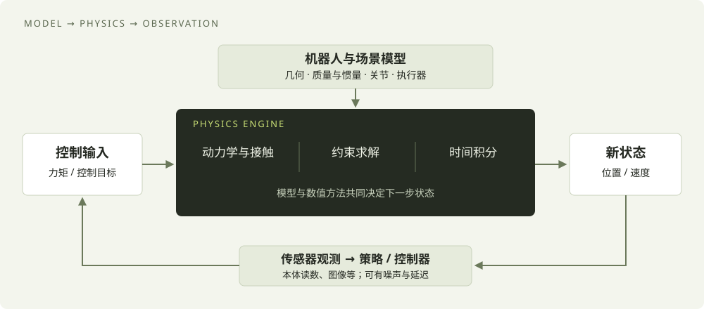

SIMULATION / FROM MODEL TO MOTION

# 仿真：让世界成为可检查的模型。

机器人怎样在模拟世界中运动？接触力怎样算出来？改变一个时间步，为什么可能改变实验结论？

**从物理建模出发，理解数值求解，再用实验检查结果。** 本专题先聚焦刚体、关节和接触，沿 MuJoCo 完成一条最小实践路线。它同时服务控制、规划、强化学习与模仿学习。

小屏幕可横向滚动查看；[打开完整组成图](../assets/diagrams/simulation-loop.svg)。

图中表示职责与信息流。具体引擎可能耦合求解动力学、接触和积分；传感器、控制器与物理步进也可能运行在不同频率上。

## 先分清五个层次

| 层次 | 负责什么 | 怎样辨认 |
| --- | --- | --- |
| 模型与资产 | 身体、关节、质量、惯量、碰撞形状和视觉外观 | 一份机器人模型或场景资产仍需要引擎执行 |
| 物理引擎 | 碰撞、动力学、约束求解和状态推进 | MuJoCo 是本专题的实践引擎 |
| 求解器 | 在选定模型下求出约束力、冲量或加速度等量 | 它是引擎内部的数值计算部分，模型和求解精度需分别说明 |
| 仿真平台与学习框架 | 组织场景、传感器、并行环境与训练接口 | Isaac Sim 是平台，Isaac Lab 提供机器人学习框架；两者关系见[官方介绍](https://isaac-sim.github.io/IsaacLab/main/index.html) |
| 任务与基准 | 指定观测、动作、目标、重置和评价规则 | ManiSkill 提供操作任务与学习工具，LIBERO 提供语言条件操作基准；不能只比较项目名称 |

渲染与传感器仿真决定策略看见什么，物理计算决定动作造成什么后果。第一版深入物理计算，视觉观测、噪声与标定在后续任务中展开。

## 选择一条阅读路径

**理解原理**：从[物理模型与接触](physics.md)进入[物理求解器](solvers.md)，再阅读[时间积分与控制频率](time-stepping.md)。先理解一个方块为何停在桌面上，再检查数值方法的影响。

**动手运行**：打开[MuJoCo 最小实践](mujoco.md)，完成加载、步进、读取状态和重置，再运行[两个基础实验](../labs/simulation-basics.md)。把观察到的现象带回原理文章。

| 文章 | 要解决的问题 | 配套检查 |
| --- | --- | --- |
| [物理模型与接触](physics.md) | 模型怎样描述身体与相互作用？ | 质量、单位、碰撞几何与支撑力 |
| [物理求解器](solvers.md) | 接触和关节约束怎样参与计算？ | 求解容差与接触参数分别改变 |
| [时间积分与控制频率](time-stepping.md) | 世界怎样一步一步推进？ | 振子解析解、轨迹误差与能量 |
| [MuJoCo 最小实践](mujoco.md) | 怎样运行并检查一个最小场景？ | 版本、步进、重置与实验输出 |

## 与已有知识连接

- **数据**：[仿真数据](../data/simulation.md)继续讲示范生成、轨迹字段和训练用途。这里关注生成这些轨迹的世界如何运转。
- **强化学习**：[从 RL 到具身任务](../rl/to-embodied.md)把状态、观测、动作和评价落实到机器人。仿真进一步实现其中的动力学与执行接口。
- **实验室**：[仿真基础实验](../labs/simulation-basics.md)集中提供代码、参数和实际结果。浏览器振子与本地接触实验各自说明模型和运行条件。

## 这一版的范围与下一步

本版提供原理正文、浏览器振子和 CPU 上可运行的 MuJoCo 接触实验。它们验证数值机制与简化场景，不代表完成机器人策略训练。

后续按[学习路线](../roadmap.md)补齐：单关节 PD 控制与多种频率、观测与任务环境、平台选型、建模误差与参数敏感性。域随机化实验将记录为仿真鲁棒性证据；迁移效果另由真实设备测试验证。

## 一手资料

- [MuJoCo 3.3.7 概览](https://mujoco.readthedocs.io/en/3.3.7/overview.html)与[计算原理](https://mujoco.readthedocs.io/en/3.3.7/computation/index.html)：本版实验固定对应版本。
- [Modern Robotics](https://modernrobotics.northwestern.edu/nu-gm-book-resource/)：刚体运动、动力学与控制的背景。
- [ManiSkill 官方文档](https://maniskill.readthedocs.io/en/latest/)与[LIBERO 项目](https://github.com/Lifelong-Robot-Learning/LIBERO)：理解任务工具与基准的职责。
